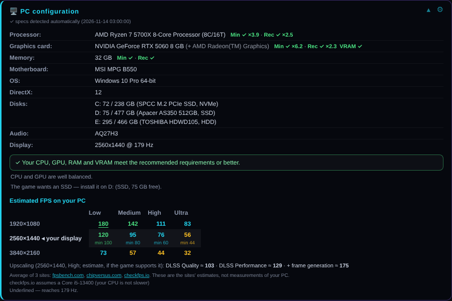
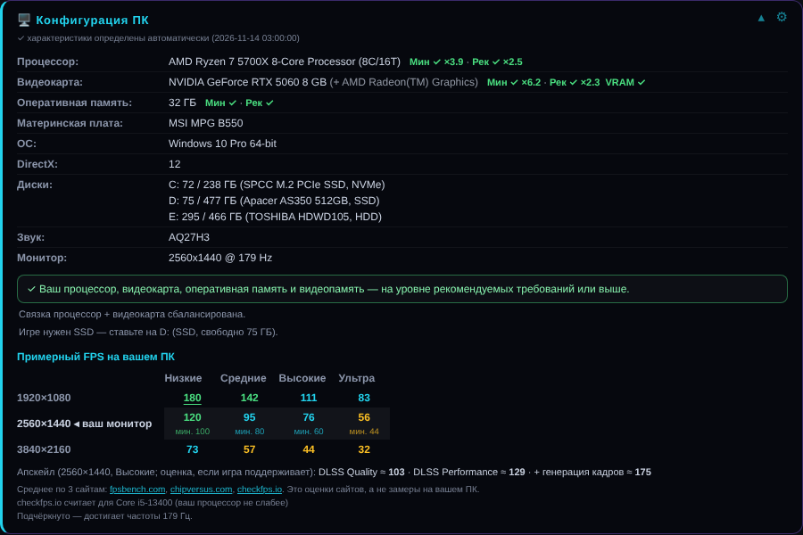
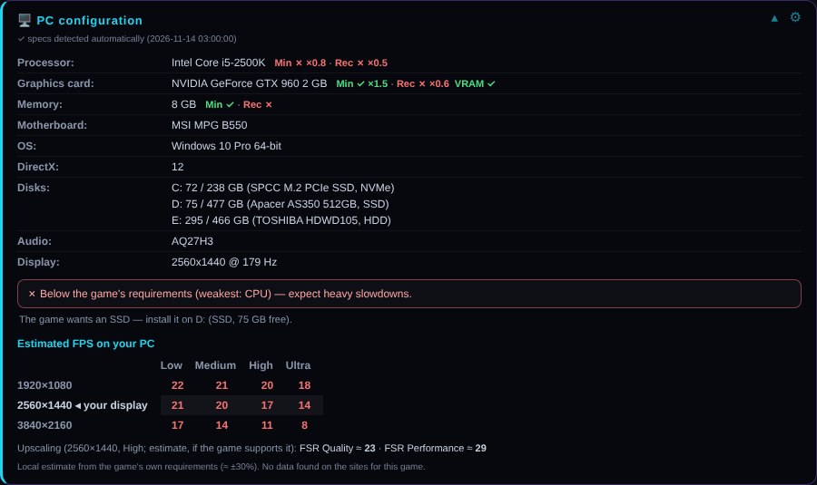
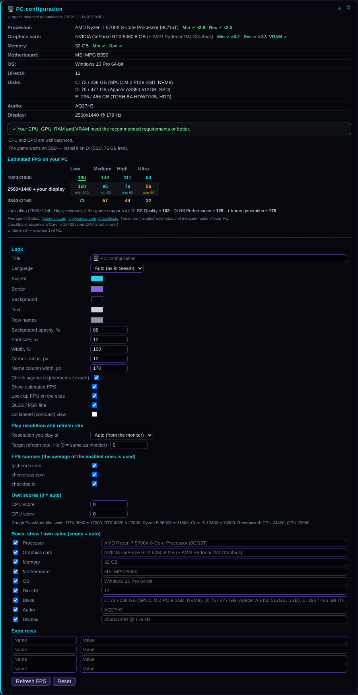

# PC Info (Night Neon) — Millennium plugin

Adds a **«🖥️ PC configuration»** block under *System requirements* on every game page of the Steam store.
The block shows your CPU, GPU, RAM, motherboard, OS, DirectX, disks (free / total), audio device and monitor,
and marks RAM and free disk space with ✓ / ✗ against the game's minimum requirements.
**v2.1+:** it also compares your **CPU and GPU** with the minimum / recommended requirements of the game and shows an
**approximate FPS table** (1080p / 1440p / 4K × Low / Medium / High / Ultra).

Добавляет на страницы игр в магазине Steam, под «Системными требованиями», блок **«🖥️ Конфигурация ПК»**:
процессор, видеокарта, ОЗУ, материнская плата, ОС, DirectX, диски (свободно / всего), звук и монитор.
Память и место на диске сверяются с минимальными требованиями игры (✓ / ✗).
**v2.1:** процессор и видеокарта сравниваются с минимальными и рекомендуемыми требованиями игры, ниже — таблица
**примерного FPS** (1080p / 1440p / 4K × низкие / средние / высокие / ультра).

## How it works / Как это работает

* The block appears instantly with built-in default specs (`DEFAULT_DATA` at the top of `.millennium/Dist/webkit.js` — edit it for your PC).
  Блок появляется сразу со встроенными данными по умолчанию.
* In parallel the Lua backend runs a small PowerShell script that detects the real hardware and the block is updated.
  Параллельно бэкенд определяет железо через PowerShell и обновляет блок.
* A gear button (⚙) on the block opens settings: title, colors, opacity, font size, width, radius, show/hide rows,
  your own values for any row, 4 extra rows. Saved in the browser storage of the store.
  Шестерёнка ⚙ на блоке: заголовок, цвета, прозрачность, размер, ширина, строки, свои значения, 4 дополнительные строки.

## Screenshots / Скриншоты

Rendered by the plugin itself on a test page (the numbers are illustrative) / Снято самим плагином на тестовой странице (числа условные).

| Full block / Полный блок | Russian UI / Русский интерфейс |
|---|---|
|  |  |

| Compact / Компактный | Weak PC / Слабый ПК | Settings / Настройки |
|---|---|---|
|  |  |  |

## Checks and FPS / Проверки и FPS

* **Requirements check.** The "Processor / Graphics / Memory / Storage" lines of the game are parsed and compared with your PC:
  CPU and GPU through a built-in table of **approximate** relative scores (hand-written, PassMark-like),
  RAM and video memory (`2GB VRAM`) by size, SSD by disk type. You get `Min ✓ ×2.3 · Rec ✓ ×1.3`:
  ✓ at or above the requirement, ≈ within 15 %, ✗ weaker. Unknown models show `?` (and "⚠ not recognised — enter score",
  which opens the settings where you can type your own score) — nothing is guessed.
  Several alternatives ("i5-8600K or Ryzen 5 3500") → the weakest one is the threshold.
* **Hints.** bottleneck (CPU vs GPU), SSD advice with the disk to install on (needs the disk type from the helper),
  laptop CPUs/GPUs (U/H/HX, Max-Q) are scaled down, integrated + discrete GPU are both listed.
* **FPS table (1080p / 1440p / 4K × Low … Ultra).** The plugin asks **all enabled** FPS-estimate sites
  (`fpsbench.com`, `chipversus.com`, `checkfps.io`, through the Lua backend `FetchPage`, allow-list of these hosts only)
  and shows the **average**; hover a cell to see each site's own number. checkfps assumes a Core i5-13400 and is rescaled
  to your CPU when yours is slower; its "min" FPS is shown for your resolution. If no site knows the game, a **local estimate** is shown,
  computed from the game's own requirements (min ≈ 30 FPS at 1080p low, recommended ≈ 60 FPS at 1080p high), accuracy ≈ ±30 %.
  Site values are the sites' estimates, not measurements of your PC. Results are cached 7 days.
* **DLSS / FSR line** — an estimate (Quality ×1.35, Performance ×1.7, frame generation ×1.7) for RTX / RX / GTX / Arc cards.
* **Your resolution and refresh rate.** Choose the resolution you really play at and a target Hz; the row is highlighted and
  cells that reach the target are underlined.
* **Compact view** (▴ button): one line with the verdict and the FPS at your resolution.
* **DLC pages** without their own requirements use the base game's (fetched from the store).
* **English / Russian**, auto-detected from the Steam page language (override in the settings).
* Gear → every feature can be switched off; "Refresh FPS" clears the cache.
* Debug: `document.documentElement.dataset.pcinfoFps` in the store page console lists what each site answered.

Not done / Не сделано: a pass/fail column in the Steam **Library** and Workshop pages (needs the client UI class names),
and a settings page inside the Millennium plugin menu (needs the TypeScript frontend + pnpm build).

## Install / Установка

1. Close Steam / Закройте Steam.
2. Copy this folder to `<Steam>\millennium\plugins\pc-info` (older Millennium: `<Steam>\plugins\pc-info`) /
   Скопируйте папку в `<Steam>\millennium\plugins\pc-info`.
3. Steam → Millennium → Plugins → enable **PC Info (Night Neon)** → Save → restart Steam.
4. Open any game page in the store, press Ctrl+R.

Requires a Millennium version with Lua plugins (3.x) and Windows (hardware detection uses PowerShell).
Нужен Millennium с поддержкой Lua-плагинов (3.x) и Windows.

## Structure / Структура

| Path | Purpose |
|---|---|
| `plugin.json` | plugin manifest |
| `backend/main.lua` | Lua backend: runs detection, serves `GetPcInfo()` and `FetchPage(url)` |
| `backend/pc-info.ps1` | hardware detection (PowerShell) |
| `.millennium/Dist/webkit.js` | webkit module injected into store pages |
| `.millennium/Dist/index.js` | empty frontend module |
| `src/` | readable sources of `webkit.js` (`pcinfo-core.js`, `pcinfo-hw.js`) and `build.py` that produces it |

## Troubleshooting / Если блока нет

* Millennium → Logs: look for `pc-info: detected: {...}`.
* `backend/pc-info.log` — helper log; `<Steam>\steamui\pc-info\data.js` must exist.
* In the store page console (`http://localhost:8080`): `document.documentElement.dataset.pcinfo` →
  `init` = the module runs; `undefined` = not injected.

## Privacy / Приватность

Hardware information is read locally. With "Искать FPS на сайтах" enabled the plugin requests pages from
`fpsbench.com`, `chipversus.com` and `checkfps.io`; the URL contains the game name and your CPU/GPU model name, nothing else
(no account, no Steam ID, no other hardware data). Turn it off in the gear panel to stay fully offline.
Settings stay in your browser storage.
Железо читается локально. При включённом «Искать FPS на сайтах» плагин запрашивает страницы трёх сайтов; в адресе — только
название игры и модели вашего процессора/видеокарты. Отключается в настройках (⚙).

## License

GPL-3.0 — see [LICENSE.txt](LICENSE.txt).
